# Potahto

Potahto is a pocket multitool I built around a Seeed XIAO ESP32-S3, plus the firmware that runs it. It has a 128x64 OLED, a 5-way switch, a motion sensor, a compass, a time-of-flight distance sensor, a buzzer, a vibration motor, an RGB LED and an IR transmitter/receiver. The firmware turns that into a sensor toolbox, a Bluetooth/USB keyboard and air mouse, a slide clicker, a smart home button, a desk companion and a small game console.

It started as "make the air mouse work" and kept growing. Most of the effort went into making everything feel like one device instead of a pile of demos: everything shares one settings system, things keep running with the screen off and anything that works over USB also works over Bluetooth.

Current version: 1.3.0. Built and tested with the esp32 Arduino core 3.3.12.

<table>
<tr><td align="center">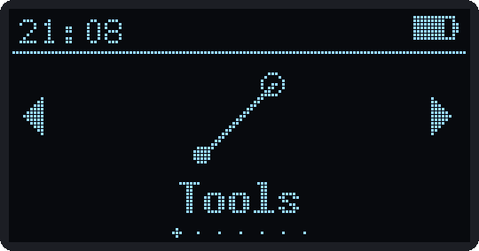<br><sub>Main menu</sub></td><td align="center">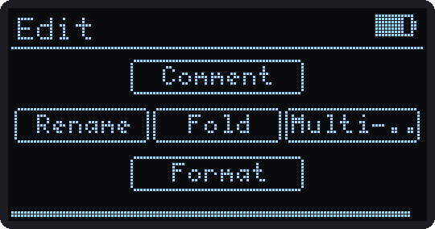<br><sub>Macro Pad, VS Code folder</sub></td><td align="center">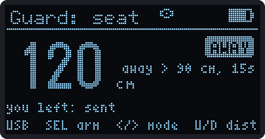<br><sub>Desk Guard</sub></td></tr>
<tr><td align="center">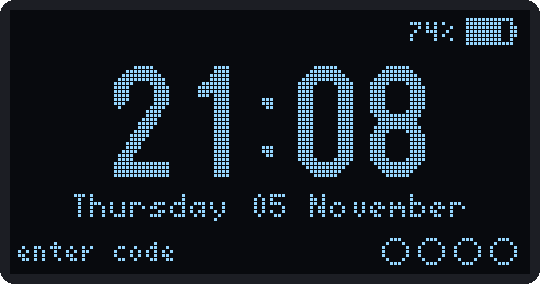<br><sub>Lock screen</sub></td><td align="center">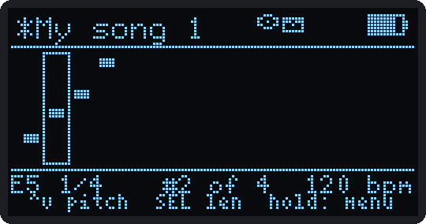<br><sub>Buzzer composer</sub></td><td align="center">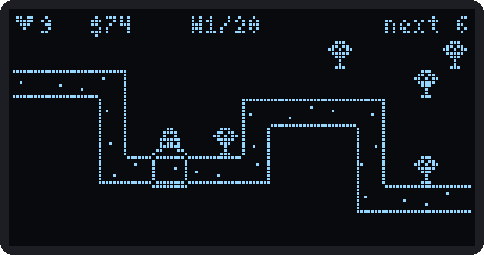<br><sub>Spud Defense</sub></td></tr>
</table>

These are the real firmware screens, captured from the PC simulator in `_dev/oled`. There are more in [docs/SCREENS.md](docs/SCREENS.md).

## What it does

The menu is a carousel of folders.

| Folder | Apps |
|--------|------|
| Tools | IR Remote, Motion (level, accel, gyro, temp), Light, Compass, Scale (ToF), Tripwire, Music |
| Control | Air Mouse, Macro Pad, Presenter, Shutter |
| Wireless | WiFi Scan, BLE Scan, LAN Scan, Net Doctor, Wake PC |
| Smart | Smart Button, Smart Status |
| Desk | Clock (alarms, timer), Pomodoro, PC Monitor, Desk Guard, Inbox |
| Games | Spud Knight, Tater Run, Spud Defense, Snake, Pong, Tetris, Flappy, Dungeon, Tilt Maze, Tilt Race, Blaster, Sonar |
| System | Connect, Settings, Battery, Power |

Controls are the same everywhere: the D-pad moves and adjusts, tap SELECT to do the thing, hold SELECT for back. Keep holding SELECT for 1.5 s and the screen turns off. Every screen has a hint line at the bottom.

There's also a web app for everything that's annoying to do with five buttons. The device serves it over WiFi. You can also open `webapp/index.html` locally in Chrome or Edge and connect over USB or Bluetooth.

## Hardware

The full parts list, wiring and assembly steps are in the **[build guide](docs/BUILD.md)**. The short version:

| Part | Notes |
|------|-------|
| Seeed XIAO ESP32-S3 | the non-Sense version is fine (the buzzer and LED pins are on the back, see the build guide) |
| SSD1306 OLED, 128x64, I2C | `0x3C` |
| MPU6050 | `0x68` |
| HMC5883L or QMC5883L compass | auto-detected (`0x1E` / `0x0D`) |
| VL53L0X ToF sensor | `0x29` |
| 5-way switch | to GND, internal pull-ups |
| Vibration motor | through a PNP transistor (active LOW) |
| Passive buzzer | straight off a GPIO |
| WS2812 LED | one pixel |
| IR LED + IR receiver | 38 kHz |
| Small Li-ion cell | voltage divider into the ADC |

| Function | GPIO |
|----------|------|
| UP / DOWN / LEFT / RIGHT / SELECT | 4 / 2 / 3 / 43 / 44 |
| Motor | 7 |
| Buzzer | 16 |
| WS2812 | 12 |
| IR TX / RX | 9 / 8 |
| Battery ADC | 1 |
| I2C SDA / SCL | 5 / 6 (D4 / D5) |

GPIO43/44 are the UART pins, but serial runs over native USB, so they're free for buttons. GPIO3 is a strapping pin, so don't hold LEFT while powering up. If your buttons go to 3V3 instead of GND, set `BTN_ACTIVE_LOW 0` in `Config.h`. If your motor uses a low-side NPN/MOSFET, set `MOTOR_ACTIVE_LOW 0`.

## Flashing the firmware

Arduino IDE with the esp32 core 3.x (tested on 3.3.12). Board settings:

| Option | Value |
|--------|-------|
| Board | XIAO_ESP32S3 |
| USB Mode | USB-OTG (TinyUSB), needed for USB keyboard/mouse |
| USB CDC On Boot | Enabled |
| Partition Scheme | Default with spiffs (3MB APP/1.5MB SPIFFS) |

Libraries from the Library Manager:

| Library | Version | For |
|---------|---------|-----|
| U8g2 (olikraus) | 2.35+ | the display |
| Adafruit NeoPixel | 1.12+ | the LED |
| Adafruit MPU6050 | 2.2+ | motion (pulls in Unified Sensor and BusIO) |
| VL53L0X (Pololu, not Adafruit) | 1.3+ | distance |
| IRremote (Armin Joachimsmeyer) | 4.x | IR |
| NimBLE-Arduino (h2zero) | 2.x | Bluetooth HID, scanner, data link |
| ArduinoJson (Benoit Blanchon) | 7.x | web app protocol, macro/song/smart home files |

MQTT, HTTPS, mDNS, OTA and the web server come with the ESP32 core.

The sketch folder has to match the `.ino` name, so keep it in a folder called `potahto`.

If the upload can't find the port (TinyUSB re-enumerates), hold BOOT while plugging it in, upload, then press RESET. After the first USB flash you can update over WiFi from the web app's Firmware page or the IDE's network port (`potahto`, password = web PIN).

Settings are stored one NVS key per setting, so flashing new firmware keeps them. Macros, songs and smart home config live in LittleFS and survive updates too. The web app's Backup page exports everything as one JSON file.

## Power

It behaves like a phone. The screen turns off after 30 s (configurable) or when you hold SELECT, but alarms, timers, Tripwire, Desk Guard and notifications keep running. The CPU drops to 80 MHz, idle sensors sleep and WiFi goes into modem sleep.

Air Mouse, Macro Pad, Presenter, Shutter, Smart Button and Light keep taking button presses with the screen off, so you can click through slides or fire macros without lighting it up. In other apps the first press just wakes the screen.

The lock screen can be off, a clock, or a code (4 to 6 presses of UP/DOWN/LEFT/RIGHT). It locks after the screen has been off for a couple of minutes, or right away from Power > Lock now.

Deep sleep kicks in after 30 min of screen-off (or from Power > Deep sleep). Only UP, DOWN and LEFT can wake it because those are the RTC pins. The clock keeps running and alarms still wake it. It won't deep sleep while something needs to stay awake, like an armed Tripwire, a running timer, USB plugged into a PC or WiFi set to Always on.

<table>
<tr><td align="center">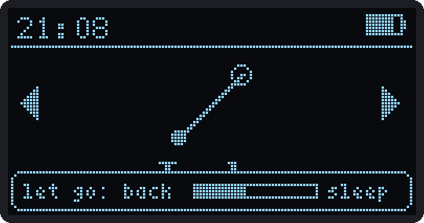<br><sub>Hold SELECT: screen off</sub></td><td align="center">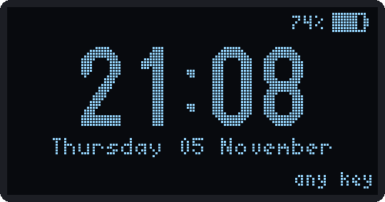<br><sub>Clock lock screen</sub></td><td align="center">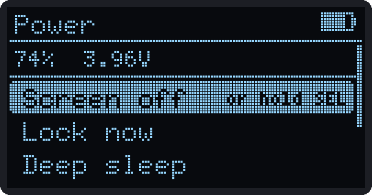<br><sub>Power app</sub></td></tr>
</table>

## WiFi, Bluetooth and time

Join networks on the device (Settings > WiFi > Join a network, with an on-screen keyboard) or from the web app. Up to 5 are saved. Campus or office WiFi that asks for a username and password while connecting (WPA2-Enterprise, PEAP or TTLS) works; the kind that opens a login web page doesn't.

WiFi modes:
- Off
- On demand (default): online for 2 minutes after power-up and whenever an app needs it
- Always on: costs battery, but the web app and Home Assistant can reach it any time

Bluetooth pairs once as a combined keyboard, mouse and media remote called "Potahto". With "Send keys via" on Auto, whichever connection came last wins, so plugging in USB or connecting over Bluetooth just does the right thing. In Air Mouse, hold UP to switch by hand.

The clock doesn't need WiFi. It takes the time from NTP, from the web app or companion over USB or Bluetooth, from an iPhone (Bluetooth Current Time Service), or you set it by hand.

<table>
<tr><td align="center">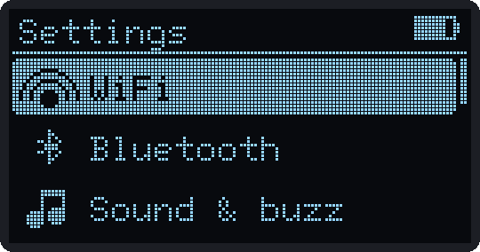<br><sub>Settings</sub></td><td align="center">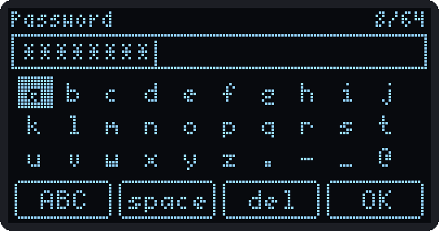<br><sub>Typing a WiFi password</sub></td><td align="center">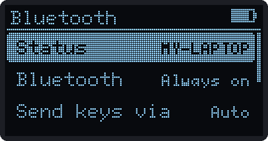<br><sub>Bluetooth</sub></td></tr>
</table>

## The control apps

All of these work over USB and Bluetooth.

**Air Mouse.** Tilt to move while holding DOWN (you can flip that so it moves unless you hold DOWN). LEFT/RIGHT click, hold LEFT to drag, UP re-centers, SELECT toggles roll-to-scroll. Sensitivity, axes and smoothing are in Settings > Air Mouse.

**Macro Pad.** Each profile maps macros to the D-pad. Two layouts:
- "Hold = 2nd macro" gives 9 per profile.
- "Hold = folder" gives 25: hold a direction to open a folder of 5.

Starter profiles cover Windows, media keys, VS Code, Chrome, PowerPoint, Teams and Zoom. The web app has a library with more (Word, Excel, Figma, Discord, Spotify, OBS and so on). With the PC companion running, the pad can switch to the right profile when you switch apps.

Macro syntax (the web app checks it as you type):

```
Hello                     types the text (US layout)
{ctrl+shift+t} {win+d}    key combos, {f13}..{f24} for AutoHotkey
{media playpause}         also next, prev, volup, voldown, mute
{mouse left} {scroll -3}  mouse
{delay 300}               wait
{run notepad}             Win+R, type it, Enter
{cmd ipconfig /all}       run in a command prompt
{admin ipconfig /flushdns}  same, as administrator (accepts UAC with Alt+Y, English Windows)
{pc shutdown /h}          the PC companion runs it (only with --allow-run)
{pointer drag}            hand over to the tilt pointer
```

`{pointer}` is the fun one. Snip is `{win+shift+s}{pointer drag}`: press it, then hold SELECT and tilt to draw the box.

**Presenter.** RIGHT or tap DOWN for next, LEFT/UP for previous. Hold DOWN for an on-screen laser pointer you move by tilting (PowerPoint laser, Google Slides laser or the plain cursor). Hold LEFT to set a talk length. The motor gives a double buzz a few minutes before the end, a long buzz at zero and a short one every minute of overtime. Works with the screen off.

**Shutter.** A Bluetooth camera remote for phones, with self-timer, burst and wave-to-shoot over the ToF sensor.

<table>
<tr><td align="center">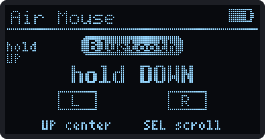<br><sub>Air Mouse</sub></td><td align="center">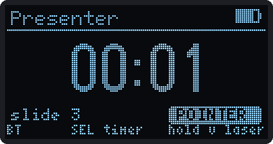<br><sub>Presenter with the laser on</sub></td><td align="center">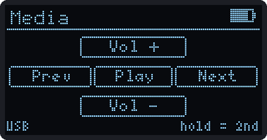<br><sub>Macro Pad</sub></td></tr>
<tr><td align="center">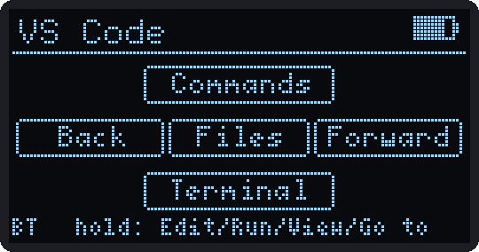<br><sub>VS Code profile</sub></td><td align="center">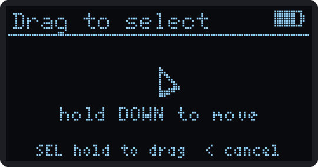<br><sub>Pointer hand-off (Snip)</sub></td><td align="center">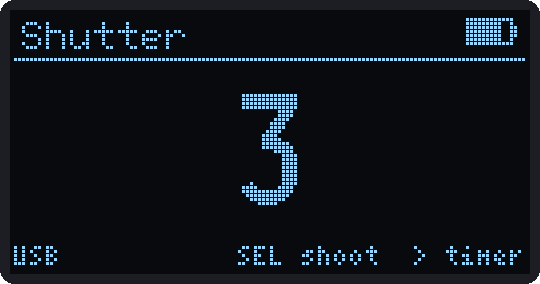<br><sub>Shutter self-timer</sub></td></tr>
</table>

## Desk stuff

- **Clock:** 3 alarms and a timer. They ring from any app, even with the screen off, and wake it from deep sleep.
- **Pomodoro:** runs in the background.
- **PC Monitor:** CPU, RAM, GPU, temperatures and network, from the companion script.
- **Desk Guard:** point the ToF sensor at your chair or behind you. In "guard my seat" mode it runs a macro when you leave (default Win+L) and another when you come back. In "watch behind me" mode it runs one when someone walks up (default Alt+Tab, but `{run chrome}` or anything else works). It keeps going after you leave the app.
- **Tripwire:** a siren tuned to the buzzer's loudest frequency, plus the motor and LED. Any key silences it. If it trips while the screen is off and a code lock is set, it locks first so only you can silence it.
- **Inbox:** notifications from the web app, Home Assistant or scripts.

<table>
<tr><td align="center">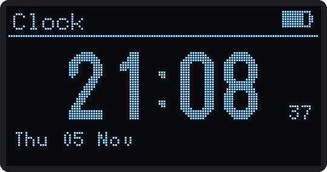<br><sub>Clock</sub></td><td align="center">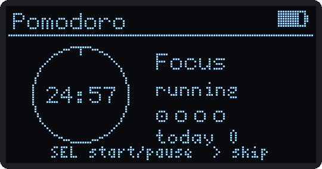<br><sub>Pomodoro</sub></td><td align="center">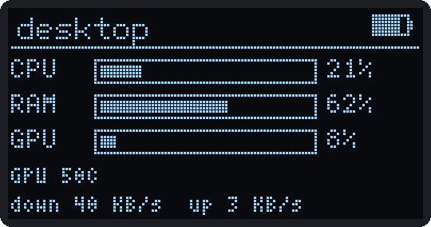<br><sub>PC Monitor</sub></td></tr>
<tr><td align="center">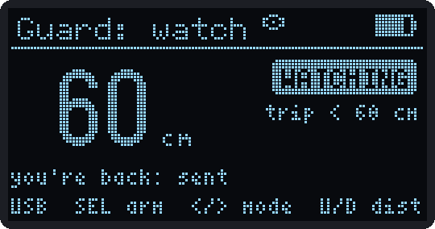<br><sub>Desk Guard, watch mode</sub></td><td align="center">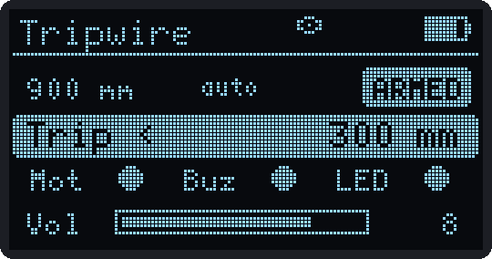<br><sub>Tripwire armed</sub></td><td align="center">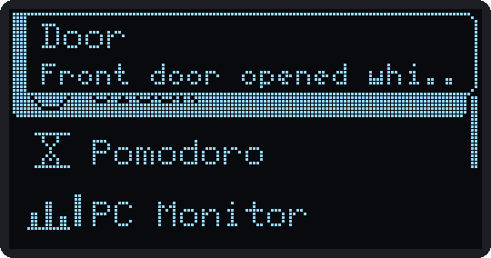<br><sub>Notification banner</sub></td></tr>
</table>

### PC companion

`companion/potahto_companion.py` feeds PC Monitor, keeps the clock synced, tells the Macro Pad which app is in front, runs `{pc ...}` macros and lets scripts send notifications.

```
pip install psutil pyserial bleak         # bleak only for --ble
python potahto_companion.py                 # USB
python potahto_companion.py --ble           # Bluetooth
python potahto_companion.py --wifi potahto.local --pin 123456
python potahto_companion.py --allow-run     # let {pc ...} macros run commands
python potahto_companion.py --notify "Build finished"
```

`--allow-run` runs whatever a `{pc ...}` macro says with your user rights, so only turn it on for your own PC.

## Smart home

From the web app's Smart page:
- **Home Assistant:** turn on MQTT and Potahto shows up through discovery, with battery, temperature, WiFi signal, Tripwire and presence sensors, a Ring button, a Message box and a device trigger for every Smart Button press.
- **Webhooks:** any URL, bound to Smart Button keys or to rules like "when Tripwire trips, call this".

<table>
<tr><td align="center">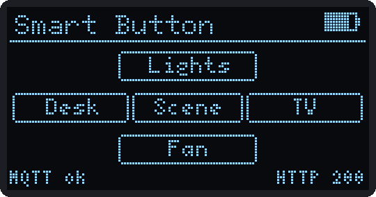<br><sub>Smart Button</sub></td><td align="center">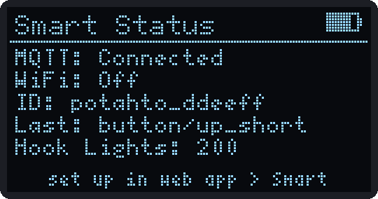<br><sub>Smart Status</sub></td></tr>
</table>

## Music

Tools > Music plays songs on the buzzer and has a composer. There are 16 slots of up to 512 notes, plus 17 original built-in tunes (every game has its own theme). Songs are RTTTL, so old Nokia ringtones paste right in. The web app has a piano-roll editor. Any song can be the alarm, timer, message or boot tone.

<table>
<tr><td align="center">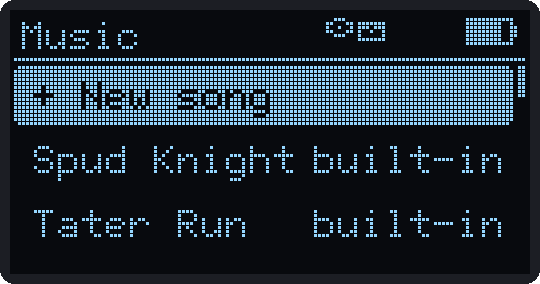<br><sub>Music library</sub></td><td align="center"><br><sub>Composer</sub></td><td align="center">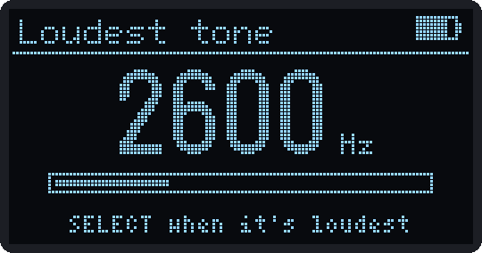<br><sub>Finding the loudest tone</sub></td></tr>
</table>

## Wireless toolkit

For your own networks and devices only. Nothing in here attacks, jams or deauths anything.
- **WiFi Scan:** signal, channels, a channel crowding chart and a "hunter" that beeps faster as signal improves.
- **BLE Scan:** nearby devices, plus a finder for a lost earbud or tag.
- **LAN Scan:** mDNS devices on your network.
- **Net Doctor:** checks link, gateway, DNS, internet and latency and tells you which one is broken.
- **Wake PC:** Wake-on-LAN.

<table>
<tr><td align="center">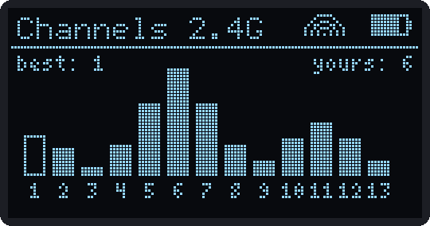<br><sub>Channel crowding</sub></td><td align="center">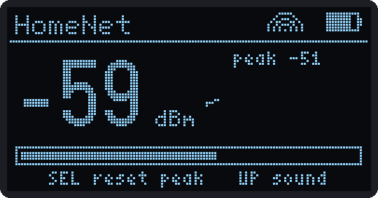<br><sub>Signal hunter</sub></td><td align="center">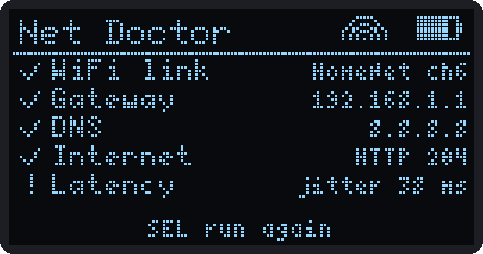<br><sub>Net Doctor</sub></td></tr>
</table>

## Games

Three bigger originals made for this screen:
- **Spud Knight:** an action roguelite with room-by-room floors, bosses every third floor and permanent upgrades from banked coins.
- **Tater Run:** a platformer with 4 worlds of 6 levels, hidden fries and best times. It's tuned so jumping feels right on a single 5-way switch.
- **Spud Defense:** tower defense, 4 gardens of 20 waves.

Plus Snake, Pong, Tetris (hold it sideways), Flappy, a dungeon crawler and four sensor games: Tilt Maze, Tilt Race, Blaster (gyro aim) and Sonar (fly with your hand over the distance sensor).

<table>
<tr><td align="center">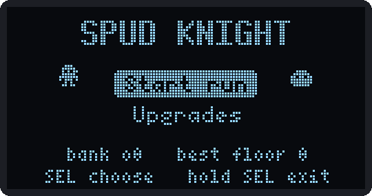<br><sub>Spud Knight</sub></td><td align="center">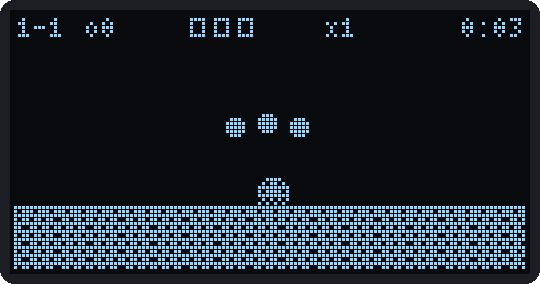<br><sub>Tater Run</sub></td><td align="center">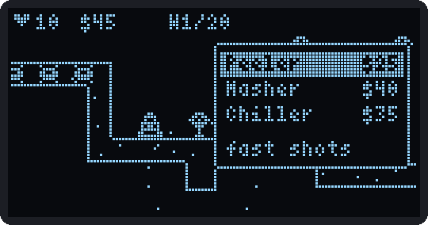<br><sub>Spud Defense</sub></td></tr>
</table>

## Tuning after the first flash

1. Battery divider: Settings > Device. Adjust until the voltage matches a multimeter.
2. Gyro: lay it flat, Settings > Sensors > Calibrate gyro.
3. Level: Settings > Sensors > Set level.
4. Buzzer: Settings > Sound & buzz > Find loudest tone. Press SELECT when it's loudest. The alarms and Tripwire siren use that tone.
5. Compass: open Compass, press SELECT, rotate it through every orientation, press SELECT. Point at north and press RIGHT.
6. If an Air Mouse direction is backwards, fix the axis/invert settings (all of them are under Advanced in the web app).

## Hardware limits worth knowing

- **Buzzer volume:** a buzzer on a GPIO gets 3.3 V and a few tens of mA. The firmware already drives it as hard as it can at its resonant frequency. For real volume, drive it from the battery through a transistor: GPIO16 > 1k > NPN base (S8050 or 2N2222), emitter to GND, buzzer between VBAT and collector, with a diode across it if it's a magnetic buzzer.
- **IR range:** same story. A GPIO pin can push maybe 40 mA through the LED, while a TV remote pulses 100 to 300 mA. GPIO9 > 1k > NPN (or an AO3400 MOSFET), with the LED and a 10 to 15 ohm resistor from VBAT. That goes from a couple of metres to across the room.

## What's next

Nothing here is promised, but this is roughly the order I want to do things in.

**Soon**
- Test everything on the real hardware and fix what breaks: deep sleep current, Bluetooth keyboard plus the data link at the same time, campus WiFi.
- Prebuilt `.bin` files on the Releases page, so you can flash it without setting up the Arduino IDE.
- Measure real battery life in each power mode and put the numbers here.

**Hardware rev 2**
- Transistor drivers for the buzzer and the IR LED (see the limits above). That's the biggest easy win for volume and range.
- A proper enclosure and a small PCB instead of hand wiring.

**Firmware ideas**
- Macros for non-US keyboard layouts plus `{run}` / `{admin}` equivalents for macOS and Linux.
- An IR code library (TVs, ACs, projectors) on top of record and replay.
- Checking the campus WiFi certificate instead of trusting any server.
- Switching between more than one paired Bluetooth host from the device.
- Firmware updates from the web app straight from GitHub releases.
- More games and a way to share songs and macro profiles.

Ideas and pull requests are welcome.

## Code layout

```
potahto.ino            setup() and the main loop
Multitool.h            the one header every file includes
Config.h               pins and constants
Settings.*             settings, stored per key in NVS, with UI metadata
App*.cpp               one file per app (AppDesk and AppWireless hold several)
Game*.cpp              games
Hid.* HidMacro.cpp     USB + Bluetooth keyboard/mouse, macro engine
Net.* WebSrv.cpp       WiFi, hotspot, mDNS, NTP, OTA, web server
Proto.* BleLink.*      JSON protocol over USB serial, HTTP and Bluetooth
Power.* TimeSvc.*      screen off, lock, deep sleep, clock
Watch.*                Tripwire and Desk Guard
Music.*                songs and buzzer playback
Pointer.* Kbd.*        tilt pointer, on-screen keyboard
Iot.* Notify.* Desk.*  smart home, notifications, alarms/timer/pomodoro
WebApp.h               the web app, gzipped (generated)
webapp/index.html      web app source
companion/             PC companion script
docs/                  build guide and screenshots
_dev/                  test tools (simulators, unit tests), not part of the build
```

After editing `webapp/index.html` or the companion script, run `python _dev/embed_webapp.py` to regenerate `WebApp.h`.

`_dev/` has the tools I used to test without the hardware: unit tests for the macro engine and settings, a simulator that runs the real UI code on a PC and dumps the screen to PNGs and a device simulator that the web app's Playwright tests run against. See `_dev/README.md`.

## Credits

QR codes use [ricmoo/QRCode](https://github.com/ricmoo/QRCode) (MIT), vendored as `PotQR.*`. Thanks to the authors of U8g2, NimBLE-Arduino, ArduinoJson, IRremote and the Pololu and Adafruit libraries.
