# Screens

Every screen here is the real firmware running in the PC simulator (`_dev/oled`), drawn pixel for pixel like the 128x64 OLED. Network names, PCs and sensor readings are fake test data.

## Menu and system

<table>
<tr><td align="center">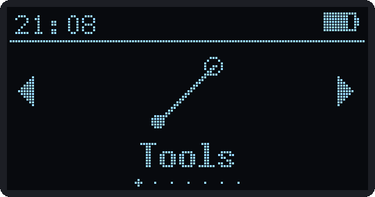 Folder carousel</td><td align="center">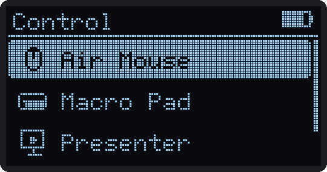 App list</td><td align="center">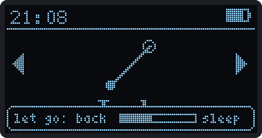 Hold SELECT for screen off</td></tr>
<tr><td align="center">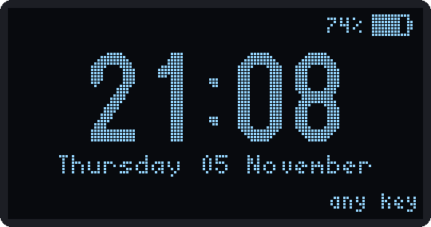 Lock screen (clock)</td><td align="center">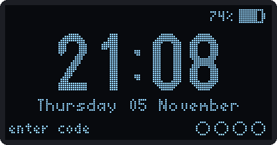 Lock screen (code)</td><td align="center">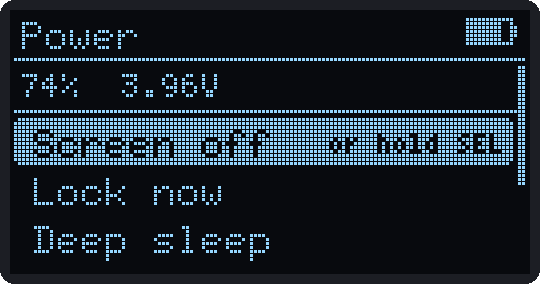 Power</td></tr>
<tr><td align="center">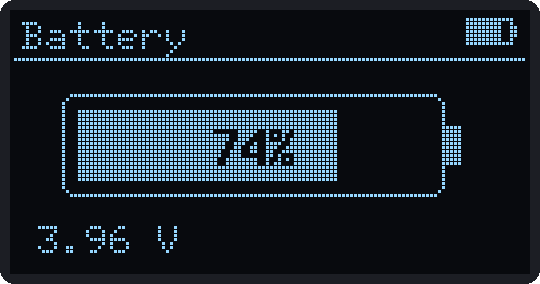 Battery</td><td align="center">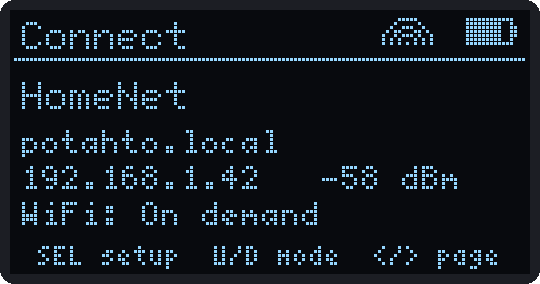 Connect</td><td align="center">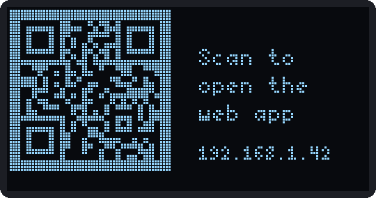 QR code for the web app</td></tr>
</table>

## Settings

<table>
<tr><td align="center">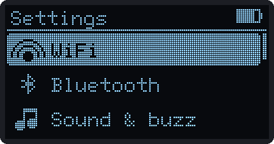 Categories</td><td align="center">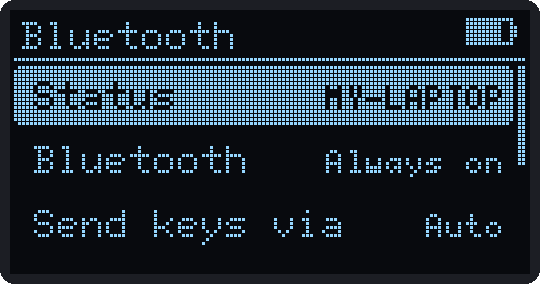 Bluetooth</td><td align="center">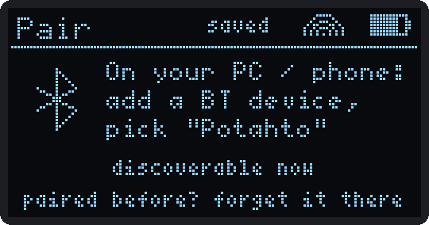 Pairing</td></tr>
<tr><td align="center">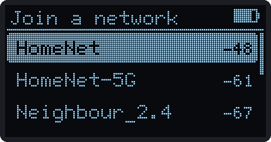 Joining a network</td><td align="center">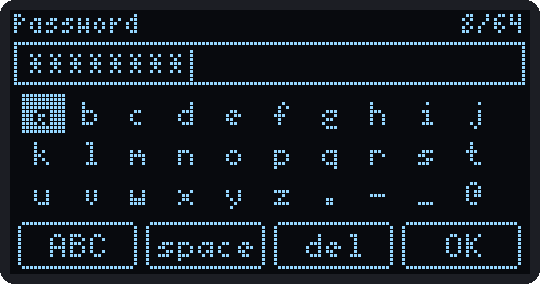 On-screen keyboard</td><td align="center">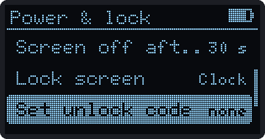 Power & lock</td></tr>
<tr><td align="center">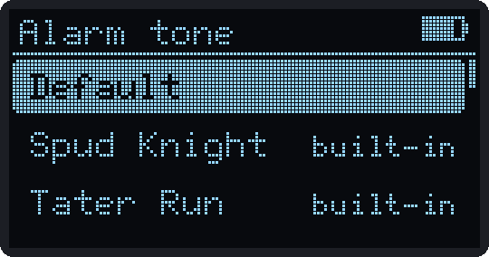 Picking an alarm tone</td><td align="center">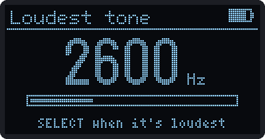 Finding the buzzer's loudest tone</td><td align="center">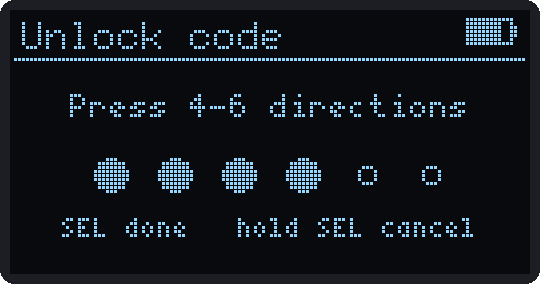 Setting an unlock code</td></tr>
</table>

## Tools

<table>
<tr><td align="center">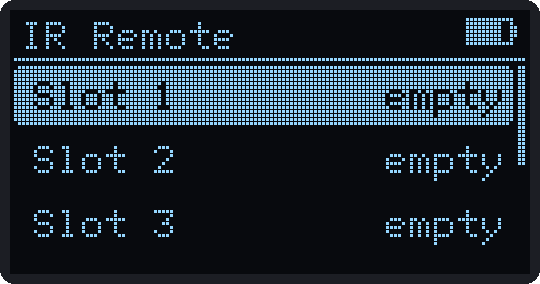 IR Remote</td><td align="center">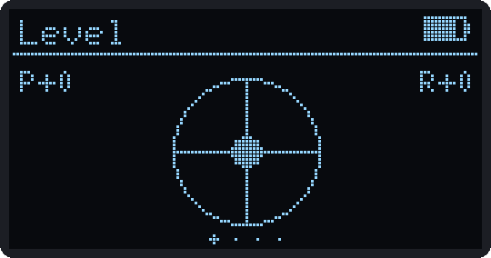 Level</td><td align="center">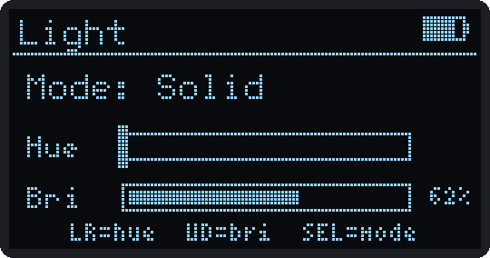 Light</td></tr>
<tr><td align="center">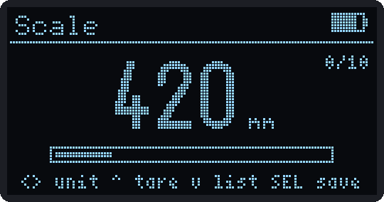 Scale</td><td align="center">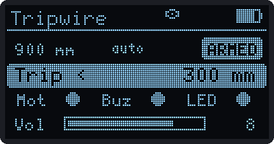 Tripwire</td><td align="center">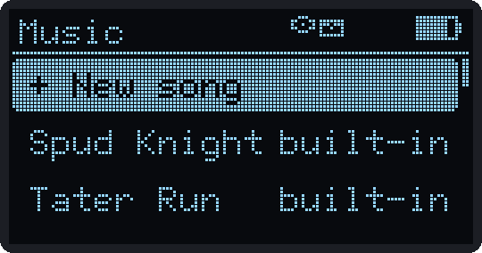 Music library</td></tr>
<tr><td align="center">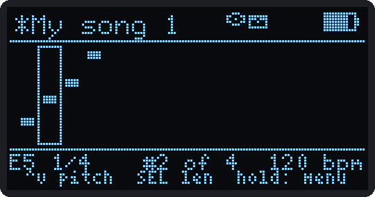 Composer</td><td align="center">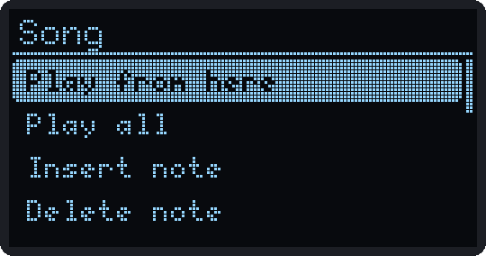 Composer menu</td></tr>
</table>

## Control

<table>
<tr><td align="center">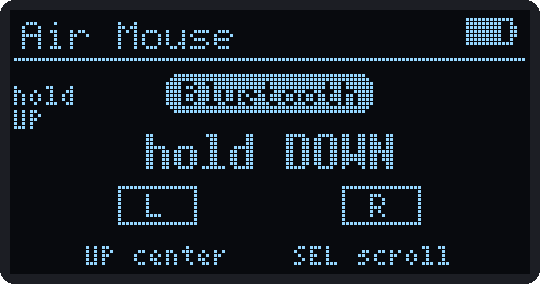 Air Mouse</td><td align="center">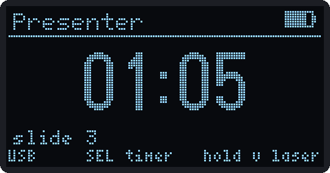 Presenter, talk timer running</td><td align="center">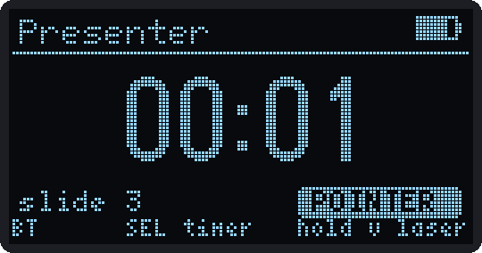 Presenter, laser pointer</td></tr>
<tr><td align="center">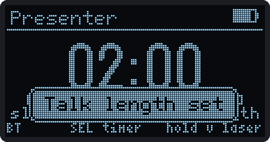 Talk length set</td><td align="center">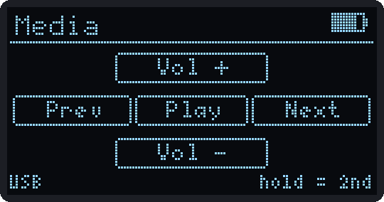 Macro Pad (Media)</td><td align="center">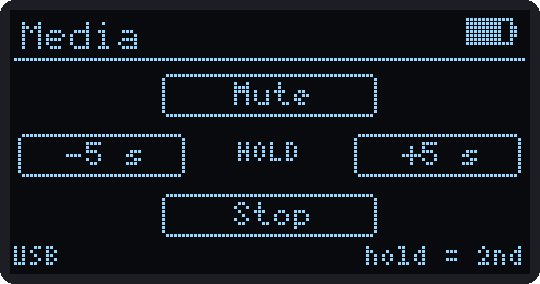 Hold layer preview</td></tr>
<tr><td align="center">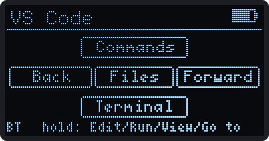 VS Code profile</td><td align="center">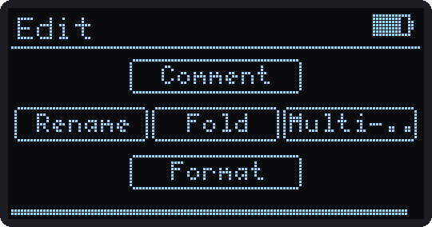 Inside a folder</td><td align="center">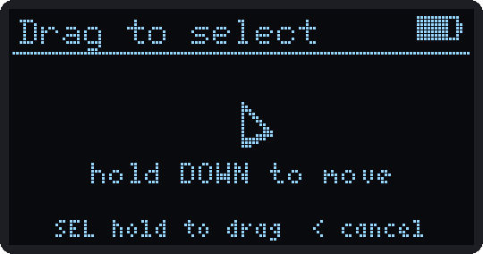 Pointer hand-off</td></tr>
<tr><td align="center">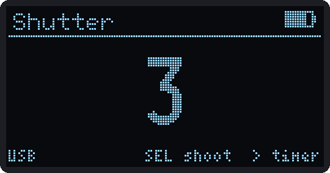 Shutter self-timer</td></tr>
</table>

## Desk

<table>
<tr><td align="center">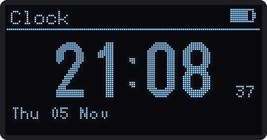 Clock</td><td align="center">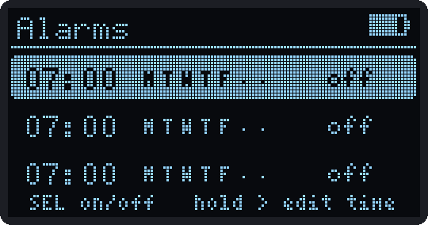 Alarms</td><td align="center">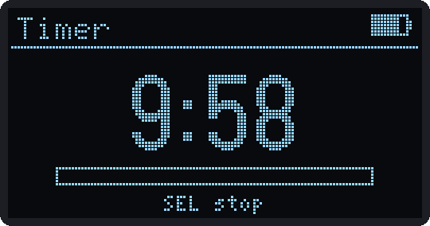 Timer</td></tr>
<tr><td align="center">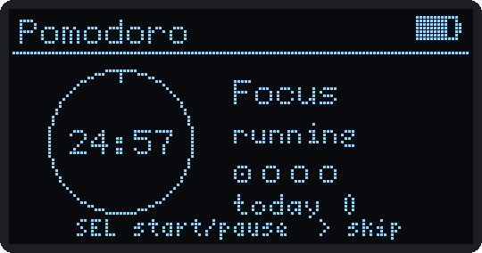 Pomodoro</td><td align="center">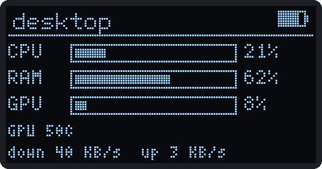 PC Monitor</td><td align="center">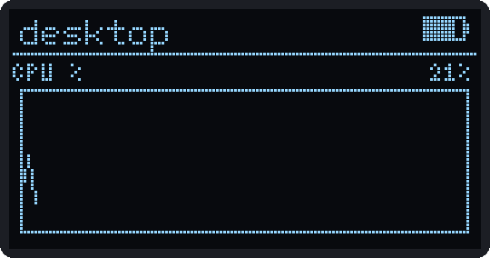 PC Monitor graph</td></tr>
<tr><td align="center">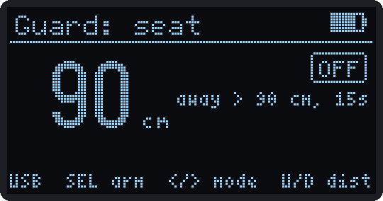 Desk Guard</td><td align="center">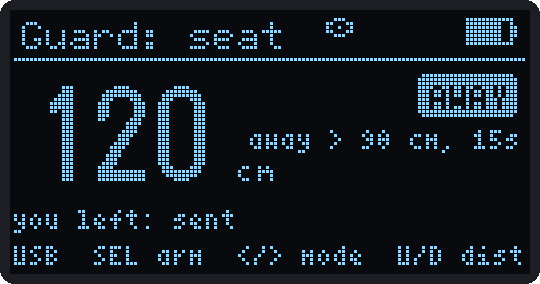 Desk Guard, you left</td><td align="center">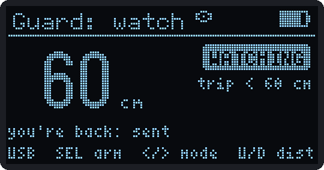 Desk Guard, watch mode</td></tr>
<tr><td align="center">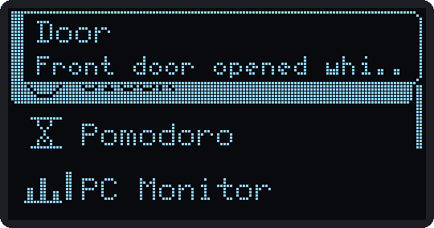 Notification banner</td><td align="center">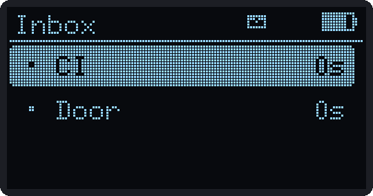 Inbox</td><td align="center">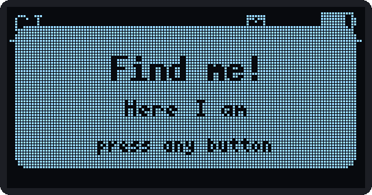 Find me</td></tr>
</table>

## Smart home

<table>
<tr><td align="center">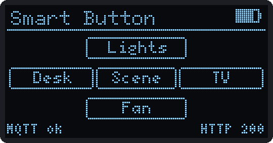 Smart Button</td><td align="center">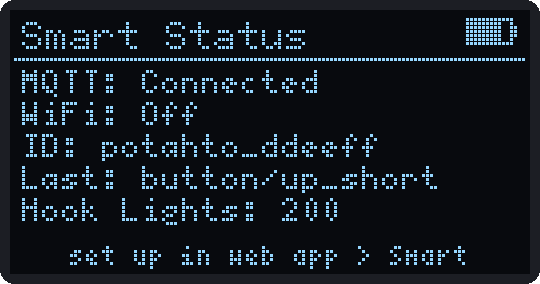 Smart Status</td></tr>
</table>

## Wireless

<table>
<tr><td align="center"> WiFi Scan</td><td align="center"> Channel crowding</td><td align="center"> Signal hunter</td></tr>
<tr><td align="center"> BLE Scan</td><td align="center"> BLE finder</td><td align="center"> LAN Scan</td></tr>
<tr><td align="center"> Net Doctor</td><td align="center"> Wake PC</td></tr>
</table>

## Games

<table>
<tr><td align="center"> Games hub</td><td align="center"> Spud Knight</td><td align="center"> Spud Knight, new floor</td></tr>
<tr><td align="center"> Tater Run levels</td><td align="center"> Tater Run</td><td align="center"> Spud Defense gardens</td></tr>
<tr><td align="center"> Spud Defense, building</td><td align="center"> Spud Defense, wave 1</td></tr>
</table>

To make these yourself: build the simulator with `bash _dev/oled/build_oled.sh`, then run any script in `_dev/oled/scripts/`.
